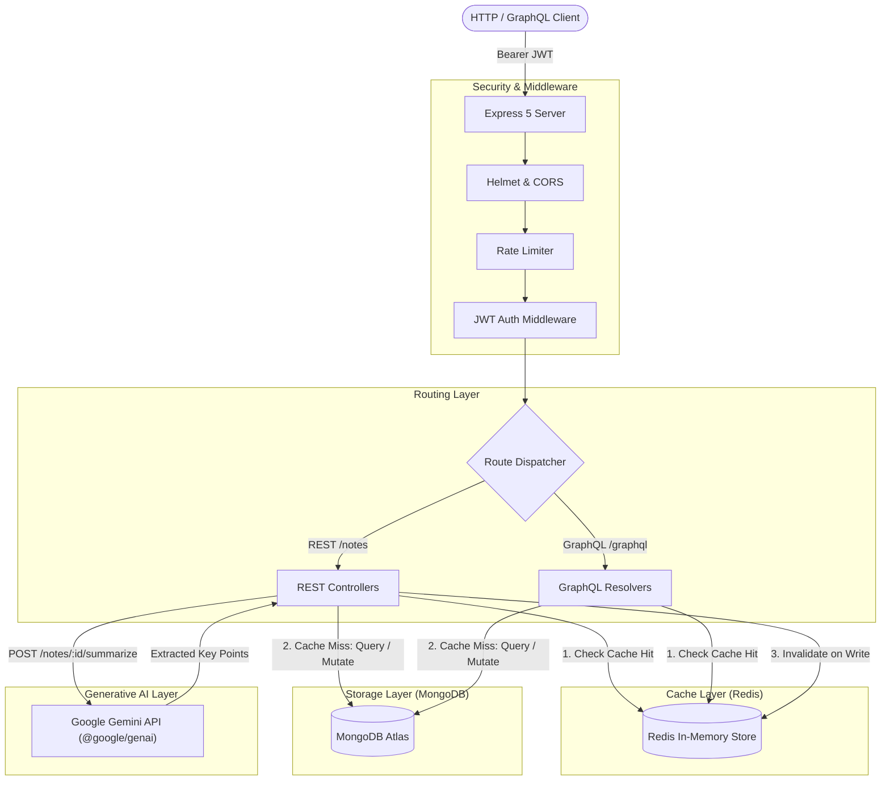

<div align="center">

# Smart Note API

**High-performance note-taking REST & GraphQL backend featuring Redis caching, JWT authentication, and Google Gemini AI summarization.**

[](https://nodejs.org/)
[](https://expressjs.com/)
[](https://www.mongodb.com/)
[](https://redis.io/)
[](https://graphql.org/)
[](https://ai.google.dev/)

> Engineered backend demonstrating clean layered architecture, cache invalidation, rate limiting, and generative AI integration.

</div>

---

## Features

- **Layered Clean Architecture:** Strict separation between controllers, services, repositories, and data models.
- **Cache-Aside Redis Strategy:** Sub-millisecond reads for paginated note lists with automatic cache invalidation on write/update/delete operations.
- **Dual API Surface:** Full RESTful endpoints alongside a unified `/graphql` schema for flexible querying.
- **AI-Powered Synthesis:** Integrated Google Gemini API (`@google/genai`) to produce concise architectural and executive summaries from long-form notes.
- **Enterprise Security Baseline:** Hardened with Helmet HTTP headers, IP-based rate limiting (`express-rate-limit`), input validation (`Joi`), and Argon2/Bcrypt password hashing.
- **Structured Observability:** High-throughput JSON logging using Pino with pretty-print development formatting.

---

## System Architecture



---

## Prerequisites

- **Node.js** v18.0.0 or higher
- **pnpm** (preferred) or npm
- **MongoDB** instance (local or MongoDB Atlas connection string)
- **Redis** server (local or managed instance)
- **Google Gemini API Key** (from [Google AI Studio](https://aistudio.google.com/app/apikey))

> [!TIP]
> You can spin up both MongoDB and Redis locally in seconds via Docker:
> ```bash
> docker run -d -p 27017:27017 --name mongo-dev mongo:latest
> docker run -d -p 6379:6379 --name redis-dev redis:latest
> ```

---

## Quick Start

### 1. Clone & Install Dependencies

```bash
git clone https://github.com/KareemAdelAwwad/Smart-Note-App.git
cd Smart-Note-App
pnpm install
```

### 2. Configure Environment Variables

Create a `.env` file in the root directory:

```env
PORT=3000
MONGO_URI=mongodb://localhost:27017/smart-note-app
REDIS_URL=redis://localhost:6379
JWT_SECRET=your_super_secret_jwt_key
GEMINI_API_KEY=your_gemini_api_key

# Optional: Email & Cloudinary media storage
GOOGLE_APP_EMAIL=your_email@gmail.com
GOOGLE_APP_PASSWORD=your_app_password
CLOUDINARY_CLOUD_NAME=your_cloud_name
CLOUDINARY_API_KEY=your_api_key
CLOUDINARY_API_SECRET=your_api_secret
```

### 3. Run the Server

```bash
# Development mode with native watch
pnpm run dev

# Production mode
pnpm start
```

The server will listen on [http://localhost:3000](http://localhost:3000).

---

## API Reference

### Authentication

| Method | Endpoint | Description | Auth Required |
| :--- | :--- | :--- | :---: |
| `POST` | `/register` | Register a new user account | No |
| `POST` | `/login` | Authenticate user & issue JWT | No |
| `POST` | `/logout` | Revoke active session token | Yes |
| `POST` | `/forgot-password` | Dispatch OTP password reset email | No |
| `POST` | `/reset-password` | Verify OTP & set new password | No |
| `POST` | `/upload-profile` | Upload profile avatar to Cloudinary | Yes |

### Notes

| Method | Endpoint | Description | Caching |
| :--- | :--- | :--- | :---: |
| `GET` | `/notes` | Retrieve paginated notes (`?page=1&limit=10`) | **Redis Cached (60s)** |
| `GET` | `/notes/:id` | Fetch specific note by MongoDB ID | **Redis Cached** |
| `POST` | `/notes` | Create a new note | **Invalidates Cache** |
| `PUT` | `/notes/:id` | Update note content or tags | **Invalidates Cache** |
| `DELETE` | `/notes/:id` | Remove note | **Invalidates Cache** |
| `POST` | `/notes/:id/summarize` | Generate structured AI summary with Gemini | On-Demand AI |

### GraphQL

Send `POST` requests to `/graphql` with a JSON payload:

```graphql
query GetUserNotes {
  notes(page: 1, limit: 5) {
    id
    title
    content
    createdAt
  }
}
```

---

## Author

**Kareem Adel**
- Website: [kareem-adel.com](https://kareem-adel.com)
- GitHub: [@KareemAdelAwwad](https://github.com/KareemAdelAwwad)
- LinkedIn: [linkedin.com/in/kareem-adel-awwad](https://linkedin.com/in/kareem-adel-awwad)
